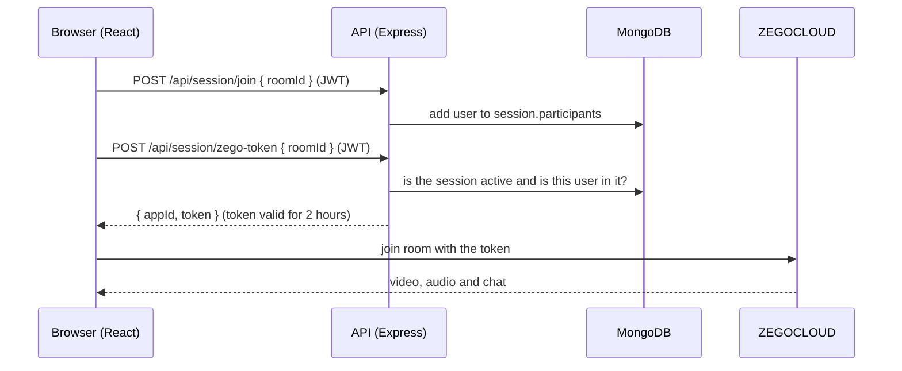

# ClassSync — Live Learning Platform

ClassSync lets a host start a live session and share a room ID or link; participants join from the browser with group video, text chat and a participant list.

Built with **React**, **Node.js / Express 5**, **MongoDB (Mongoose)** and the **ZEGOCLOUD UIKit** for video.

## Features

- Sign up / sign in with JWT authentication (passwords hashed with bcrypt)
- Create a session in one click; every session gets a random room ID
- Join with a room ID or a shareable link (`/join?roomId=...`)
- Group video, text chat and participant list (ZEGOCLOUD UIKit, WebRTC-based)
- Only the host can end a session; participants are sent back to the dashboard when it ends
- Dashboard with your active and past sessions, and one-click rejoin
- **Video tokens are created on the server.** The browser never sees the ZEGOCLOUD ServerSecret; it gets a short-lived token, and only if it has joined that session

## How it works



## Project structure

```
client/                 React app (Create React App + Tailwind CSS)
  src/context/          AuthContext, SessionContext (API calls)
  src/hooks/useZego.js  Video room state for a page
  src/service/zego.js   Joins / leaves the ZEGOCLOUD room
  src/pages/            Home, Auth, Dashboard, JoinSession, SessionRoom
server/                 Express 5 API
  controllers/          auth and session logic
  middleware/           JWT auth, validation, error handling
  model/                User and Session (Mongoose)
  routes/               /api/auth, /api/session
  utils/zegoToken.js    Creates ZEGOCLOUD tokens on the server
  test/                 Unit tests (node --test)
```

## Run it locally

You need Node.js 18+, a MongoDB database (local or Atlas) and a ZEGOCLOUD project (AppID + ServerSecret from the ZEGOCLOUD Admin Console).

```bash
# 1. Backend
cd server
cp .env.example .env      # fill in MONGO_URI, JWT_SECRET, ZEGO_APP_ID, ZEGO_SERVER_SECRET
npm install
npm run dev               # http://localhost:5000

# 2. Frontend (new terminal)
cd client
cp .env.example .env      # REACT_APP_API_URL=http://localhost:5000/api
npm install
npm start                 # http://localhost:3000
```

### Environment variables

| Where | Name | What it is |
| --- | --- | --- |
| server | `MONGO_URI` | MongoDB connection string |
| server | `JWT_SECRET` | Long random string used to sign login tokens |
| server | `JWT_EXPIRES_IN` | Login token lifetime (default `7d`) |
| server | `CLIENT_URL` | Frontend URL(s) allowed by CORS, comma-separated |
| server | `ZEGO_APP_ID` | ZEGOCLOUD AppID (number) |
| server | `ZEGO_SERVER_SECRET` | ZEGOCLOUD ServerSecret (32 characters). **Server only** |
| server | `ZEGO_TOKEN_TTL_SECONDS` | Video token lifetime (default `7200`) |
| client | `REACT_APP_API_URL` | Backend URL ending in `/api` |

## API

All `/api/session` routes need `Authorization: Bearer <token>`.

| Method | Route | Description |
| --- | --- | --- |
| POST | `/api/auth/register` | Create an account |
| POST | `/api/auth/login` | Log in, returns a JWT |
| GET | `/api/auth/me` | Current user |
| GET | `/api/session/list?status=all\|active\|ended` | Sessions you hosted or joined |
| POST | `/api/session/create` | Start a new session (you are the host) |
| POST | `/api/session/join` | Join a session `{ roomId }` |
| POST | `/api/session/leave` | Leave a session `{ roomId }` |
| POST | `/api/session/end` | End a session `{ roomId }` (host only) |
| POST | `/api/session/zego-token` | Video token for a session you are in `{ roomId }` |
| GET | `/api/session/:roomId` | Session details |
| GET | `/api/health` | Health check |

## Tests

```bash
cd server && npm test            # token generator, auth header parsing, room IDs
cd client && npm test            # helper functions (Jest via react-scripts)
```

## Deployment

- **Frontend:** Vercel (set `REACT_APP_API_URL`). `client/vercel.json` sends every route to `index.html` so links like `/join?roomId=...` work on refresh.
- **Backend:** any Node.js host such as Render or Railway (set the server variables above, and `CLIENT_URL` to the frontend URL).
